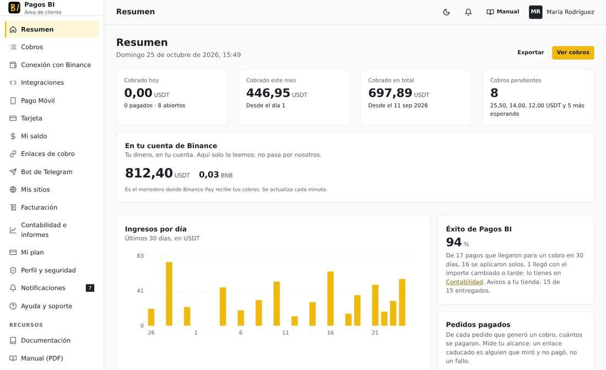
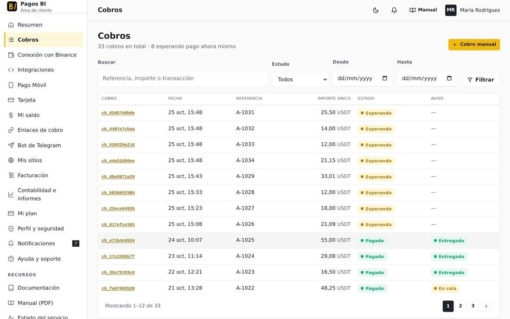
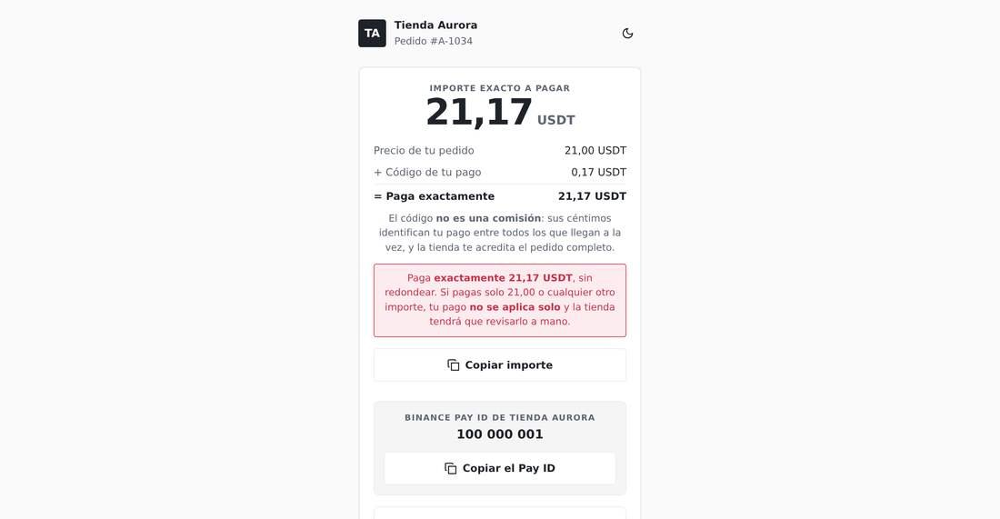
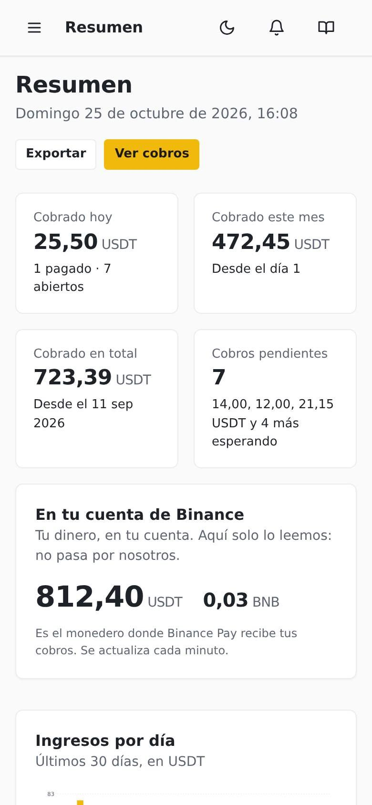
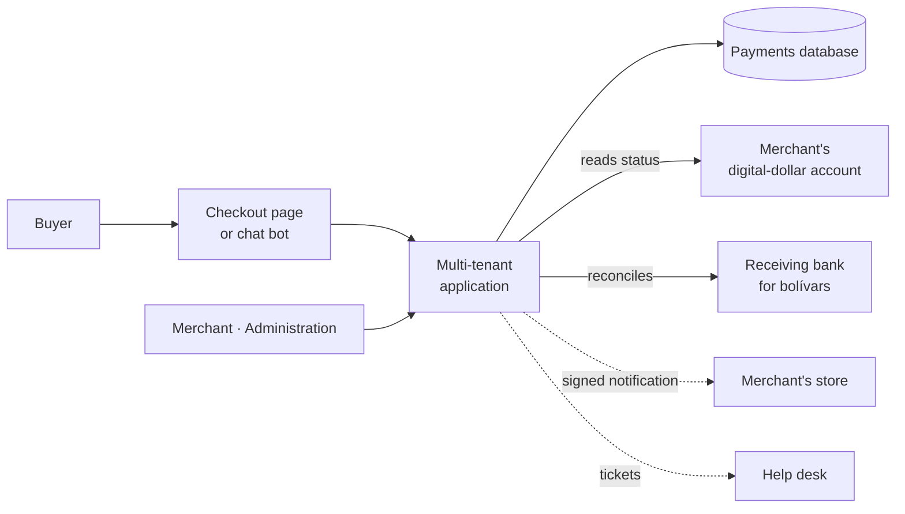

# Pagos BI

> A multi-tenant payments platform for Latin American merchants. It collects in
> digital dollars and in Venezuelan bolívars, confirms every payment on its own
> and notifies the merchant's store with a signed message.

**Status:** in production at [pagosbi.com](https://pagosbi.com) ·
**Proprietary system** by Kusarive Solutions LLC ·
[Versión en español](README.md) ·
[Presentation page](https://rjblancos.github.io/pagosbi-showcase/)

---

## The problem

A small merchant selling online or over chat faces two problems at once:
getting paid in dollars is hard, and confirming by hand who paid for what eats
up the day.

Pagos BI solves both. The merchant, or their store, creates a payment request.
The buyer pays, and the platform tells that payment apart from every other one
arriving. It then confirms it and notifies the store so the order is delivered,
with nobody checking statements.

## What it does

- **Two payment rails on a single checkout page.** One in digital dollars,
  which go straight to the merchant's own account. The other in bolívars through
  instant interbank mobile transfer, reconciled against the bank and credited as
  merchant balance.
- **Automatic confirmation by exact amount.** Every payment request gets an
  amount that is unique within its window, and a payment is applied only when
  it matches to the cent. Anything else is never guessed: it goes to manual
  review.
- **Signed notification to the merchant's store.** The store can verify every
  notification, and crediting is idempotent: a repeated notification never
  delivers twice.
- **Full merchant dashboard.** Payments, payment links, connected sites, balance
  and withdrawals, accounting with export, billing and plan.
- **Selling from a chat bot.** Each merchant connects their own bot and sells
  there: catalog, payment, confirmation and order status in one conversation.
- **Ready-made module for hosting billing platforms.** With it, a hosting
  company collects its invoices through the same rails.
- **Controlled withdrawals.** Bolívar balance is withdrawn to a bank account or
  in digital dollars. Digital-dollar withdrawals only go to verified
  destinations.
- **Built-in support.** Tickets opened from the dashboard reach the company's
  help desk, and replies flow back to the merchant.
- **Public user manual** of more than 80 pages, with a screenshot of every
  screen.

## Benefits

| For the merchant | |
|---|---|
| **Gets paid without watching** | The payment confirms itself and the store delivers on its own. No checking the bank or the wallet. |
| **Their digital dollars are theirs** | On that rail the platform holds nothing. Money goes from the buyer to the merchant's account. |
| **Can sell without a website** | The chat bot is a complete store, and a payment link is enough to get paid over chat. |
| **Integrates in an afternoon** | One signed notification to their system and done. No library to install. |
| **Never delivers twice** | Idempotent crediting makes retries and duplicate notifications harmless. |
| **Free to try** | 30-day trial. |

| For the platform operator | |
|---|---|
| **Multi-tenant by design** | Each merchant has their own payments, bot, sites and billing, isolated from the rest. |
| **Bounded risk** | Custody exists only on the bolívar rail, which is enabled merchant by merchant. |
| **Reproducible deployment** | The whole system comes up on a fresh server from its container definition. |

## Screenshots

Sample data, made up for the manual. The interface is in Spanish.

| Merchant dashboard | Payments |
|---|---|
|  |  |

| Buyer checkout page | On mobile |
|---|---|
|  |  |

## Architecture

On the digital-dollar rail, the platform **reads** the merchant's account and
**notifies** their store, but it is never in the path of the money.

Crediting relies on a **unique amount**. Each payment gets an exact,
non-repeating amount, so the arrival of that amount identifies the payment
without ambiguity. No privileged access to the merchant's account is needed for
this. The checkout page shows it plainly: price, plus the payment code, equals
the amount to pay.

## Technical guarantees

| Area | What the system guarantees |
|---|---|
| **Security** | TOTP second factor (RFC 6238) with single-use backup codes for administration. Per-IP lockout after repeated failed attempts, including on the second factor. Built-in anti-bot check on sign-up. |
| **Payment integrity** | HMAC-signed notifications the receiver can verify. Applied by exact amount only. Idempotent crediting. |
| **Isolation** | Application code is mounted read-only, and credentials live outside the code. |
| **Quality on every change** | No change reaches production without passing **more than 140 automated checks**, plus a review in a real browser. |
| **Continuity** | Encrypted backups leave the server every day. Dual network egress to external services, with automatic failover. |
| **Operations** | The team is alerted on every withdrawal and every authorization request. An alarm fires if the system stops receiving payments when it should. |

## Results

These are real figures, read from the platform itself. They exclude tests and
internal development accounts. The
[presentation page](https://rjblancos.github.io/pagosbi-showcase/) refreshes
them every six hours.

- **725 completed payments** as of 27-Oct-2026.
- **USD 13,142 collected** as of 27-Oct-2026.
- On the digital-dollar rail, no funds are ever held in custody, by design.

## What is not in this repository

The source code is private: it is production software with real merchants
getting paid through it. This repository documents the system's capabilities
and architecture.

## Contact

Rafael Blanco, for Kusarive Solutions LLC

- Web: [pagosbi.com](https://pagosbi.com)
- Email: info@pagosbi.com
- WhatsApp: [+58 422 258 0175](https://wa.me/584222580175)

© 2026 Kusarive Solutions LLC. See [LICENSE](LICENSE).
