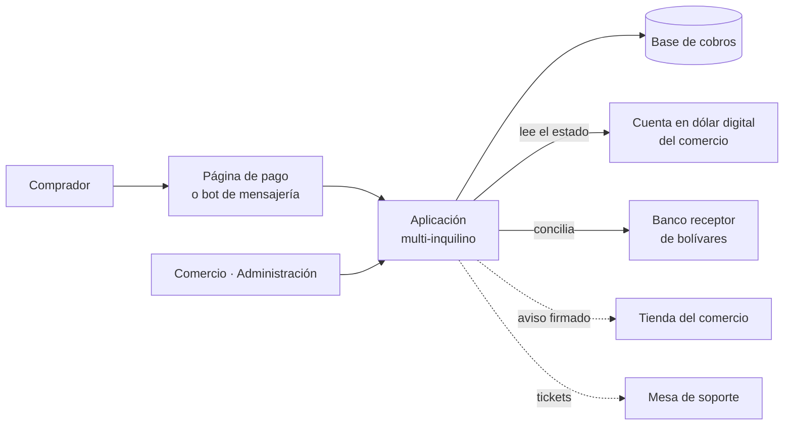

# Pagos BI

> Plataforma de cobros multi-inquilino para comercios de América Latina. Cobra
> en dólar digital y en bolívares, confirma cada pago sola y avisa a la tienda
> del comercio con un mensaje firmado.

**Estado:** en producción en [pagosbi.com](https://pagosbi.com) ·
**Sistema propietario** de Kusarive Solutions LLC ·
[English version](README.en.md) ·
[Página de presentación](https://rjblancos.github.io/pagosbi-showcase/)

---

## Qué resuelve

Un comercio pequeño que vende por internet o por mensajería tiene dos
problemas a la vez. Cobrar en dólares le cuesta, y confirmar a mano quién pagó
qué le ocupa el día.

Pagos BI resuelve los dos. El comercio crea un cobro, o se lo crea su tienda.
El comprador paga y la plataforma reconoce ese pago entre todos los que llegan.
Después lo confirma y avisa a la tienda para que entregue el pedido, sin que
nadie revise movimientos.

## Qué hace

- **Dos vías de cobro en una misma página de pago.** Una en dólar digital, que
  llega directo a la cuenta del comercio. La otra en bolívares por pago móvil
  interbancario, que se concilia con el banco y queda como saldo del comercio.
- **Confirmación automática por importe exacto.** Cada cobro recibe un importe
  irrepetible dentro de su ventana, y un pago se aplica solo si coincide al
  céntimo. Si no coincide, nunca se adivina: pasa a revisión manual.
- **Aviso firmado a la tienda del comercio.** La tienda puede verificar cada
  aviso, y la acreditación es idempotente: un aviso repetido nunca entrega dos
  veces.
- **Panel completo del comercio.** Cobros, enlaces de pago, sitios conectados,
  saldo y retiros, contabilidad con exportación, facturación y plan.
- **Venta desde un bot de mensajería.** Cada comercio conecta su propio bot y
  vende ahí: catálogo, cobro, confirmación y consulta del pedido en la misma
  conversación.
- **Módulo listo para plataformas de facturación de hosting.** Con él, una
  empresa de hosting cobra sus facturas por las mismas vías.
- **Retiros controlados.** El saldo en bolívares se retira a una cuenta bancaria
  o en dólar digital. Los retiros en dólar digital solo van a destinos verificados.
- **Soporte integrado.** Los tickets del panel llegan a la mesa de soporte de la
  empresa, y las respuestas vuelven al comercio.
- **Manual de usuario público** de más de 80 páginas, con capturas de cada
  pantalla.

## Beneficios

| Para el comercio | |
|---|---|
| **Cobra sin vigilar** | El pago se confirma solo y la tienda entrega sola. No hay que revisar el banco ni el monedero. |
| **Su dinero en dólar digital es suyo** | En esa vía la plataforma no custodia nada. El dinero va del comprador a la cuenta del comercio. |
| **Puede vender sin tener web** | El bot de mensajería es una tienda completa, y un enlace de pago basta para cobrar por chat. |
| **Integra en una tarde** | Un aviso firmado a su sistema y listo. No hay que instalar ninguna librería. |
| **Nunca entrega dos veces** | La acreditación idempotente hace inofensivos los reintentos y los avisos duplicados. |
| **Lo prueba gratis** | 30 días de prueba. |

| Para el operador de la plataforma | |
|---|---|
| **Multi-inquilino desde el diseño** | Cada comercio tiene sus cobros, su bot, sus sitios y su facturación, aislados del resto. |
| **Riesgo acotado** | La custodia solo existe en la vía en bolívares, y esa vía se habilita comercio a comercio. |
| **Despliegue reproducible** | El sistema entero se levanta en un servidor nuevo desde su definición de contenedores. |

## Capturas

Datos de ejemplo, inventados para el manual.

| Panel del comercio | Cobros |
|---|---|
|  |  |

| Página de pago del comprador | En el móvil |
|---|---|
|  |  |

## Arquitectura

En la vía en dólar digital, la plataforma **lee** la cuenta del comercio y
**avisa** a su tienda, pero no está en el camino del dinero.

La acreditación se basa en el **importe único**. Cada operación recibe una
cantidad exacta e irrepetible, así que la llegada de ese importe identifica el
cobro sin ambigüedad. Para eso no hace falta ningún permiso privilegiado sobre
la cuenta del comercio. La página de pago lo enseña tal cual: precio, más el
código del pago, igual a lo que hay que pagar.

## Garantías técnicas

| Área | Qué garantiza el sistema |
|---|---|
| **Seguridad** | Segundo factor TOTP (RFC 6238) con códigos de respaldo de un solo uso en administración. Bloqueo por IP ante intentos fallidos repetidos, también en el segundo factor. Freno anti-bot propio en el alta. |
| **Integridad de los cobros** | Avisos firmados con HMAC que el receptor puede verificar. Aplicación solo por importe exacto. Acreditación idempotente. |
| **Aislamiento** | El código de la aplicación se monta de solo lectura y las credenciales viven fuera del código. |
| **Calidad en cada cambio** | Ningún cambio llega a producción sin pasar **más de 140 comprobaciones automáticas**, más una revisión con navegador real. |
| **Continuidad** | Copias de seguridad cifradas que salen cada día del servidor. Salida de red doble hacia los servicios externos, con conmutación automática. |
| **Operación** | Avisos al equipo por cada retiro y cada solicitud de autorización. Alarma si el sistema deja de recibir pagos cuando debería. |

## Resultados

Son cifras reales y se leen de la propia plataforma. No cuentan pruebas ni
cuentas internas de desarrollo. La [página de presentación](https://rjblancos.github.io/pagosbi-showcase/)
las actualiza sola cada seis horas.

- **725 cobros completados** a 27-oct-2026.
- **13.142 USD cobrados** a 27-oct-2026.
- En la vía en dólar digital, ningún fondo queda en custodia: es así por
  diseño.

## Qué no está en este repositorio

El código fuente es privado: es software en producción con comercios reales
cobrando con él. Este repositorio documenta las capacidades y la arquitectura
del sistema.

## Contacto

Rafael Blanco, para Kusarive Solutions LLC

- Web: [pagosbi.com](https://pagosbi.com)
- Correo: info@pagosbi.com
- WhatsApp: [+58 422 258 0175](https://wa.me/584222580175)

© 2026 Kusarive Solutions LLC. Ver [LICENSE](LICENSE).
